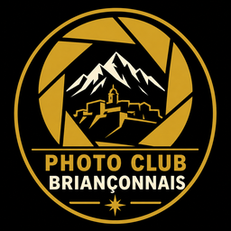

# Laboratoire du Photo Club Briançonnais

Bibliothèque photo et retouche en français pour le Photo Club Briançonnais.
Version indépendante basée sur **LightCraft 0.4.0**, par l’équipe ArtCraft et ses contributeurs,
avec les traitements locaux de PhotoLabPro. Aucun lien de parrainage avec le projet d’origine.

## Télécharger et installer

[Télécharger la dernière version Windows](https://github.com/bouyous/laboratoire-photo-club-brianconnais/releases/latest).
Ouvrir `Laboratoire-Photo-Club-0.5.1-Windows-x64-Setup.exe`. Installation pour l’utilisateur courant,
sans droits administrateur, avec raccourci et désinstalleur. Python, moteur IA et modèles sont inclus.
Les traitements IA fonctionnent hors ligne. Aucun abonnement ni compte requis pour les traitements.

**Configuration ciblée : Windows 10/11 64 bits x86-64, 8 Go de RAM minimum recommandé,
16 Go recommandé pour les RAW et l’IA, environ 1 Go disponible pour l’application**,
puis de la place pour les photos et les TIFF de résultats. Les grands fichiers demandent davantage
de RAM. L’IA fonctionne sur CPU et peut employer DirectML si le pilote le permet.
L’affichage utilise DirectX 12 ; les machines anciennes sans pilote compatible restent à vérifier.
macOS, Linux, Windows 32 bits et ARM natif ne sont pas couverts par cet installateur.
L’exécutable n’est pas signé par un certificat commercial : Windows peut afficher un avertissement
de réputation. Vérifier le SHA-256 publié avec la version ; ne télécharger que depuis ce dépôt.

## Fonctions

- Catalogue persistant, import JPEG/TIFF/RAW pris en charge par LightCraft, dossiers et albums,
  notation, filtres, développement non destructif, histogramme, curseurs et export.
- Interface française, logo du club et préférences séparées de LightCraft.
- Onglet **IA** : réduction du bruit NAFNet/SCUNet et suppression LaMa avec pinceau contrôlable,
  annulation, résultat dans un nouveau TIFF float32 et import dans la bibliothèque.
- **Supprimer → Rechercher les poussières** : propositions de taches du capteur à valider,
  toutes décochées au départ. La recherche seule ne modifie jamais la photo.

Les originaux sont référencés ou copiés selon l’option d’import ; le traitement IA crée un fichier
distinct. Conserver ses sauvegardes. Les préférences et résultats IA se trouvent sous
`%LOCALAPPDATA%\PhotoLabClub`. La bibliothèque initiale se trouve sous
`%USERPROFILE%\Pictures\PhotoLab Club Library` ; choisir un autre dossier dans les réglages.
La désinstallation conserve bibliothèque, photos, préférences et résultats.

## Limites actuelles et validation

Cette première distribution reste une **version de préproduction**. Voir [validation](docs/VALIDATION-CLUB.md).
Un seul ordinateur Windows a été testé ; aucune garantie de fonctionnement sur tous les matériels.
La détection des poussières peut manquer une tache ou proposer un détail réel : validation manuelle
obligatoire. La suppression IA reconstruit une zone et peut inventer une texture ; contrôler le résultat.
Pour les NEF Nikon compressés non décodés nativement, LightCraft peut utiliser le JPEG intégré :
ce n’est alors pas un développement des données RAW complètes. Aucun SDK Nikon ni LibRaw n’est inclus.
Les masques SAM 3 du projet d’origine sont optionnels, avec leurs propres conditions ; leurs poids
ne sont pas distribués dans cet installateur. La suppression LaMa du club n’en a pas besoin.

## Sources, modifications et licences

[Modifications](docs/MODIFICATIONS-CLUB.md) · [Licences et redistribution](docs/LICENCES-CLUB.md)
· [Recompiler](packaging/club/BUILD.md) · [Documentation technique d’origine](docs/UPSTREAM-README.md).

Code LightCraft : **MIT OU Apache-2.0**, sauf `crates/segment` : **Apache-2.0 uniquement**.
Les ajouts originaux du club et le pont PhotoLab sont proposés sous MIT OU Apache-2.0.
Les avis d’origine restent dans [NOTICE](NOTICE), [LICENSE-MIT](LICENSE-MIT) et
[LICENSE-APACHE](LICENSE-APACHE). Polices OFL, modèles et bibliothèques sous leurs licences respectives.
Le logo du club a été fourni pour cette distribution et reste distinct des licences du code.
Les marques graphiques ArtCraft ont été retirées. Ni les images personnelles de test,
ni les préférences du développeur, ni les identifiants ne sont publiés.
